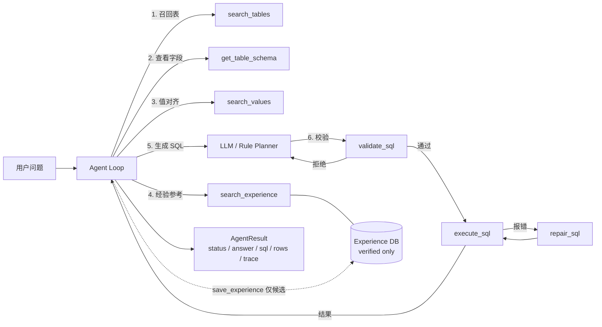

# NL2SQL Agent

面向离散制造 ERP 的 **工具调用型 NL2SQL Agent**：把自然语言问题转换成可审计、可执行、可验证的 SQL，并在失败时做确定性修复、人工升级和经验沉淀。

> 这不是一个“把 schema 拼进 prompt，然后让模型直接吐 SQL”的 demo。项目把问数拆成 **schema linking → 经验召回 → SQL 生成 → 护栏校验 → 只读执行 → 错误修复 → 结果验证** 的 Agent 循环，模型通过 8 个工具与环境交互。

[架构设计](docs/ARCHITECTURE.md) · [工具调用协议](docs/TOOL_CALLING.md) · [继续改进路线](docs/IMPROVEMENTS.md) · [从生产链路提取说明](docs/EXTRACTION.md) · [变更与评测记录](CHANGELOG.md)

---

## 为什么需要 Agent，而不是一次 LLM 调用

直接 prompt-to-SQL 在真实 ERP 上会遇到四类问题：

| 问题 | 典型表现 | 本项目对应机制 |
|---|---|---|
| Schema 幻觉 | 编造字段 `Mobile`、关联不存在的表 | Schema Catalog + `search_tables` / `get_table_schema`，护栏拒绝未知表和字段 |
| 权限越界 | 查禁用表、敏感字段、`SELECT *`、写操作 | `validate_sql` 六层只读护栏，执行前强制校验 |
| 一次生成不可靠 | JOIN 扇出、除零、字段拼写错误、GROUP BY 非法 | 执行反馈 + `repair_sql` 确定性修复 + 最多两轮重试 |
| 错误经验被强化 | 把模型自己的错误答案存进 few-shot 库 | 经验库 **candidate / verified 准入闸门**，只有人工验证过的样本可被召回 |

项目还内置 **冻结评测集 + 执行结果比对**，不只看 SQL 是否“看起来对”，而是比对真实结果集。

---

## 核心能力

- **Tool-calling Agent 循环**：OpenAI 兼容的 `tools` 协议，模型自主决定调用顺序；工具错误会作为 observation 回灌，而不是直接抛异常。
- **依赖零第三方库**：核心只用 Python 标准库（SQLite、json、dataclasses），`pip install -e .` 即可运行；只有接真实大模型时才需要 `openai` 包。
- **离线可复现**：内置规则模型 `mock`，无 API Key 也能跑通完整 Agent 循环、demo 和 CI。
- **安全护栏**：只读语句、单语句、表白名单、禁用表/字段、敏感字段、必填维度过滤、列存在性、禁止 `SELECT *`。
- **确定性修复**：清理尾逗号/分号、移除报错投影列、SQL Server 8120 的 `GROUP BY` 算术表达式包裹；修复规则可回退，不引入新表/新字段。
- **经验记忆闭环**：SQLite 持久化，schema hash 失效隔离，相似度 + 类别加权召回，命中计数；候选经验永不进入提示词。已验证经验在每轮运行前**自动注入** system prompt（默认 3 条 / 1200 字符预算），终态失败自动进入 `failure_queue` 去重排队，人工 `experience resolve` 结案必须通过护栏与真实执行，结案产物直接回流为 verified 经验。
- **评测闭环**：40 条冻结用例（37 可回答 + 3 拒答），按类别聚合，输出 JSON + Markdown 报告，含执行准确率、table recall@5、token 计量与运行元数据（provider / model / prompt_version / git_sha）。
- **AI 辅助评审（可选）**：`eval --judge` 用 LLM-as-judge 评 SQL 语义等价、回答忠实度与拒答合理性；结构化 JSON + 枚举校验 + unknown 降级 + SQLite 缓存 + 抽样/仅失败评审，`--calibrate` 在 20 条人工标注集上算一致率与 Cohen's kappa。**AI 评审只是辅助信号，绝不替代确定性结果比对**。
- **合成数据**：仓库内的 ERP schema 与数据全部虚构，不含任何公司真实表结构、客户数据或凭证。

---

## 架构



Agent 的最终输出是结构化 JSON，而不是自由文本：

```json
{
  "status": "ok | needs_clarification | needs_human | refused | failed | max_steps",
  "answer": "面向业务人员的回答",
  "sql": "实际执行并得到结果的 SQL",
  "confidence": 0.92,
  "assumptions": ["口径假设"]
}
```

**关键约束**：如果模型声称 `status=ok` 但本轮没有成功执行 SQL，Agent 会强制降级为 `needs_clarification`，杜绝“没有数据也敢报数”。

---

## 快速开始

```bash
# 1. 创建虚拟环境（Windows 用 .venv\Scripts\activate）
python -m venv .venv
source .venv/bin/activate

# 2. 安装（含测试依赖）
pip install -e ".[dev]"

# 3. 初始化合成 ERP 数据库与经验库
nl2sql-agent init

# 4. 提问
nl2sql-agent ask "2026年6月华东地区销售订单总金额是多少？" --verbose

# 5. 跑内置演示问题
nl2sql-agent demo

# 6. 跑冻结评测集（默认报告写入 reports/）
nl2sql-agent eval
```

也可以直接使用模块入口，避免安装：

```bash
PYTHONPATH=src python -m nl2sql_agent.cli eval --home .
```

编程方式调用与经验闭环示例：

```bash
python examples/run_agent.py         # 打印 AgentResult 与工具轨迹
python examples/experience_loop.py   # candidate → 人工 verify → 可召回
```

### 接入真实大模型

任何兼容 OpenAI Chat Completions 的服务都可以：

```bash
pip install -e ".[llm]"
cp .env.example .env
```

```dotenv
NL2SQL_PROVIDER=openai
NL2SQL_API_KEY=sk-...
NL2SQL_BASE_URL=https://dashscope.aliyuncs.com/compatible-mode/v1
NL2SQL_MODEL=qwen-plus
```

```bash
nl2sql-agent ask "上个月各区域的销售额排名" --verbose
```

配置项：

| 变量 | 默认值 | 说明 |
|---|---|---|
| `NL2SQL_PROVIDER` | 有 Key 时 `openai`，否则 `mock` | 模型提供方 |
| `NL2SQL_API_KEY` | 空 | 也兼容 `OPENAI_API_KEY` / `DASHSCOPE_API_KEY` |
| `NL2SQL_BASE_URL` | DashScope compatible-mode | OpenAI 兼容端点 |
| `NL2SQL_MODEL` | `qwen-plus` | 模型名 |
| `NL2SQL_MAX_STEPS` | `12` | Agent 最大工具轮次 |
| `NL2SQL_MAX_ROWS` | `200` | 单次返回行数上限（硬上限 1000） |
| `NL2SQL_QUERY_TIMEOUT_MS` | `5000` | 单条 SQL 执行超时 |
| `NL2SQL_MAX_TOKENS` | `4096` | 模型单次输出上限 |
| `NL2SQL_DISABLE_THINKING` | `true` | 发送 `enable_thinking=false`；端点不支持该字段时设为 `false` |
| `NL2SQL_ALLOW_SENSITIVE` | `false` | 是否允许敏感字段（默认禁止） |
| `NL2SQL_DEMO_TODAY` | `2026-07-01` | 演示库基准日期 |
| `NL2SQL_JUDGE_ENABLED` | `false` | 是否在 `eval` 中默认启用 AI Judge |
| `NL2SQL_JUDGE_PROVIDER` | `openai` | 评审提供方（当前仅 `openai`） |
| `NL2SQL_JUDGE_MODEL` | `qwen-max` | 评审模型，建议与生成模型不同 |
| `NL2SQL_JUDGE_BASE_URL` | 复用主配置 | OpenAI 兼容端点 |
| `NL2SQL_JUDGE_API_KEY` | 复用主 Key | 建议独立 Key，只放 `.env` |
| `NL2SQL_JUDGE_MAX_TOKENS` | `800` | 单次评审输出上限 |
| `NL2SQL_JUDGE_MAX_ROWS` | `20` | 结果集截断行数 |
| `NL2SQL_JUDGE_CACHE_PATH` | `var/judge_cache.sqlite` | 评审缓存路径 |
| `NL2SQL_JUDGE_PROMPT_VERSION` | `judge-v2` | 评审 Prompt 版本 |
| `NL2SQL_JUDGE_MAX_CALLS` | `100` | 单次 `eval` 评审调用上限 |
| `NL2SQL_FEWSHOT_ENABLED` | `true` | 是否把 verified 经验自动注入 system prompt |
| `NL2SQL_FEWSHOT_MAX` | `3` | 自动注入的经验条数上限 |
| `NL2SQL_FEWSHOT_MAX_CHARS` | `1200` | 注入块字符预算（按整条丢弃，不截断 SQL） |
| `NL2SQL_CAPTURE_FAILURES` | `true` | 终态失败（`needs_human/failed/max_steps`）是否自动入队 |
| `NL2SQL_MAX_REPAIRS` | `2` | 单题 `repair_sql` 轮次硬上限，超限直接转人工 |
| `NL2SQL_CATEGORY_BOOST` | `0.12` | 同类别 verified 经验的召回加分（`0` 关闭） |

---

## 工具清单

| 工具 | 作用 | 关键约束 |
|---|---|---|
| `search_tables` | BM25 + 同义词加权的表级 schema linking | 只返回启用表；返回列名不返回全量 DDL |
| `get_table_schema` | 获取字段、类型、敏感/禁用标记、关系、必填过滤 | 最多 8 张表；禁用列不返回 |
| `search_values` | 中文枚举值对齐（客户、物料、状态、区域） | 敏感/禁用字段直接拒绝 |
| `validate_sql` | 执行前安全与权限校验 | 6 类 error，全部阻断执行 |
| `execute_sql` | 只读执行并返回列/行/耗时/截断标记 | 先过 guard；行数、超时双限制 |
| `repair_sql` | 基于数据库错误的确定性修复 | 只做低风险、可回退修复；不新增表/字段 |
| `search_experience` | 召回人工验证过的相似问法/SQL | 只查 `verified` + 同 schema hash；同类别加分 |
| `save_experience` | 保存成功问法为候选经验 | 必须通过 guard；永远只写 `candidate` |

完整 JSON Schema 与一次真实调用轨迹见 [docs/TOOL_CALLING.md](docs/TOOL_CALLING.md)。

### 一次实际执行轨迹

```text
status: ok | confidence: 0.92 | steps: 6
sql: SELECT ROUND(SUM(oi.qty * oi.unit_price * (1 - oi.discount)), 2) AS total_amount
     FROM sales_order o JOIN order_item oi ON oi.order_id = o.order_id
     WHERE o.region = '华东' AND o.order_date >= '2026-06-01' AND o.order_date < '2026-07-01'

[1] search_tables      ok=True  :: tables=sales_order,shipment,order_item,work_order,bom,material
[2] get_table_schema   ok=True  :: schemas=sales_order,order_item
[3] search_experience  ok=True  :: count=0
[4] validate_sql       ok=True  :: valid, tables=['order_item', 'sales_order']
[5] execute_sql        ok=True  :: rows=1, truncated=False
```

---

## 安全模型

`validate_sql` 在每次执行前强制运行，检查顺序如下：

1. **只读**：仅允许 `SELECT` / `WITH`；拒绝 INSERT/UPDATE/DELETE/DDL/PRAGMA/ATTACH 等关键字；拒绝分号拼接多语句。
2. **表级权限**：只允许 Catalog 中启用且存在的表；CTE 别名不会被误判为物理表。
3. **必填过滤**：例如 `dim_lookup` 必须带 `lookup_type = 'material_category'`，防止字典串数据。
4. **列级最小化**：禁止 `SELECT *` 和 `t.*`，必须显式列出字段。
5. **敏感/禁用字段**：`customer_phone` 默认不可查，`internal_note` 不可查；表级裸列名也会被扫描。
6. **限定列存在性**：`o.custmer_name` 会被拒绝并提示 `customer_name`。

数据库连接本身使用 SQLite **只读 URI**（`mode=ro`），并设置进度处理器实现查询超时。护栏是应用层的第一道闸门，生产环境仍应使用数据库只读账号、网络隔离和审计日志作为纵深防御；它不是完整的 SQL 解析器（见[已知限制](#已知限制)）。

---

## 评测

评测不比较 SQL 字符串，而是比较 **执行结果集**：列顺序无关、行顺序可按用例标记、浮点数保留 4 位、字符串去首尾空格。

```bash
nl2sql-agent eval
```

内置 40 条冻结用例覆盖：指标聚合、分组排名、时间过滤、库存、采购、工单、BOM 递归、齐套、明细查询与拒答。

最近一次离线基线（`provider=mock`，合成库）：

| 指标 | 结果 |
|---|---|
| 用例通过 | **40 / 40** |
| Execution accuracy | **100%** |
| Valid SQL rate | **100%** |
| Execution success rate | **100%** |
| Refusal accuracy | **100%** |
| Table recall@5 | **96%**（BM25 表级召回，真实检索结果实测） |
| 平均 Agent 步数 | 5.8 |
| 平均端到端耗时 | 约 2 ms（mock） |
| Token | 0（mock 无用量；接 `openai` 后自动累计） |

> 这些数字验证的是 **Agent 编排、护栏、修复与评测链路**：`mock` 是确定性规则基线，不代表真实大模型的问数准确率。接入 `openai` 后请重新跑同一评测集，报告会记录 provider。

### AI 辅助评审（可选）

确定性结果比对始终是主指标。AI Judge 只在其之上补充语义信号，需配置 `NL2SQL_JUDGE_API_KEY`（或复用 `NL2SQL_API_KEY`）后启用：

```bash
# 全量评审
nl2sql-agent eval --judge

# 仅评审确定性失败的用例
nl2sql-agent eval --judge --judge-on-fail

# 固定种子抽样 10 条
nl2sql-agent eval --judge --judge-sample 10

# 在 20 条人工标注集上校准，计算一致率与 Cohen's kappa
nl2sql-agent eval --calibrate

# 与历史基线报告对比指标增量
nl2sql-agent eval --compare reports/eval_YYYYmmdd_HHMMSS.json
```

无 Key 时 `--judge` / `--calibrate` 会给出清晰配置提示并以退出码 `2` 结束，不影响默认确定性评测。CI 只跑离线 `mock` 评测，不调用任何真实大模型。

用本地 Key 实测（`qwen-max` 评审 `mock` 生成，合成库）后：

- **人工校准**（20 条标注集）：样本一致率 **90%**，`sql_equivalent` **95% / κ=0.857**，`answer_faithful` **95% / κ=0.857**，均达到 ≥85% / ≥0.6 门槛，故 AI 信号可作为辅助指标引用。收紧 Prompt 中 `answer_faithful`（"回答是否忠于候选结果集"）与 `answer_complete` 的定义后，faithful 一致率从 75%/κ0.47 提升到 95%/κ0.86。
- **全量评审**（40 条）：SQL/结果等价 100%、回答忠实 86.5%、回答完整 70.3%、拒答合理 100%；`--judge` 复跑命中缓存 `cache_hits=40`、零新增调用。

Judge 只补充语义信号，**execution_accuracy 仍是唯一主指标**；校准残留 2 条边界分歧（`ORDER BY` 行序、简短但可溯源的回答）如实保留，不将 20 点校准集过拟合到 100%。

报告文件：

```text
reports/eval_YYYYmmdd_HHMMSS.json   # 机器可读，含每条 SQL / 状态 / 耗时
reports/eval_YYYYmmdd_HHMMSS.md     # 人可读，含失败用例与错误原因
```

在 CI 中，评测通过与否直接决定构建是否成功。

---

## 经验记忆：为什么不会“越学越错”

```text
Agent 执行成功 ──save_experience──> candidate ──人工 verify──> verified ──自动注入 / search_experience──> few-shot
                                      │                         │
                                      └── 永不召回              └── 必须通过 SQL 护栏 + 真实执行

Agent 终态失败（needs_human / failed / max_steps）──> failure_queue（同问题同 schema 只一行，重复计 occur_count）
                                      │
                                      └── 人工 experience resolve ──guard + 真实执行通过──> resolved + verified 经验
```

- **准入闸门**：Agent 只能写候选；`verified` 必须由 CLI 人工确认，并再次通过 guard 与真实执行。
- **自动注入**：每轮运行前按类别加权召回，把 verified 经验拼进 system prompt（默认 3 条、1200 字符预算，整条丢弃不截断 SQL）；记忆层异常时静默降级为不注入，不影响答案。
- **知识失效**：经验与失败记录都带 `schema_hash`；表/字段变更后旧经验自动失效，不会污染新 schema。
- **失败闭环**：答不上的问题自动排队去重，已结案问题再次失败会重新打开；结案必须给出能通过护栏与真实执行的 SQL，杜绝“凭感觉结案”。
- **类别体系**：`taxonomy.py` 用固定词表把问法归入 `inventory/purchase/production/bom/kitting/detail/group_by/ranking/time_filter/metric`，用于召回加权与经验打类；**不用于判断是否超范围**（那由 schema 查不到表 + 护栏决定）。
- **去重**：同一归一化问题 + schema hash 唯一，避免重复样本挤占召回。
- **可观测**：`hit_count` / `last_used_at` 记录复用情况；`experience stats` 同时给出队列统计（`failures_by_category` 只统计 open，即待办积压）。

```bash
nl2sql-agent experience list --status candidate
nl2sql-agent experience verify 3
nl2sql-agent experience failures --status open        # 待人工处理的失败队列
nl2sql-agent experience resolve 1 --sql "SELECT ..." --note "口径说明"
nl2sql-agent experience stats
nl2sql-agent experience add --question "..." --sql "SELECT ..." --verified
```

---

## 项目结构

```text
src/nl2sql_agent/
├── agent.py            # Agent 循环、工具调度、最终状态校验
├── llm.py              # OpenAI 兼容 Chat Completions + tool_calls
├── mock_llm.py         # 离线规则模型（demo / CI 基线）
├── catalog.py          # Schema Catalog、schema hash、BM25 schema linking
├── guard.py            # 只读/表白名单/敏感字段/必填过滤/列校验
├── repair.py           # 确定性 SQL 修复
├── taxonomy.py         # 固定类别体系与规则分类器
├── memory/             # 经验库（candidate/verified 准入）
├── tools/              # 8 个工具及 JSON Schema 注册表
├── evaluation/         # 冻结评测集、结果集比对、AI Judge、校准、报告
├── demo/               # 合成 ERP 数据库
└── data/               # demo_schema.json / demo_cases.jsonl / judge_prompt.txt / judge_calibration.jsonl

tests/                  # 132 个单元 + 集成测试
docs/                   # 架构、工具协议、改进路线、提取说明
CHANGELOG.md            # 版本记录：评测实测结果与每个指标的定义
```

---

## 演示问题

- 2026年6月华东地区销售订单总金额是多少？
- 2026年6月各地区销售金额排名
- 销售额最高的前3个客户是谁？
- 截至2026年7月1日仍未发货的订单有哪些？
- 库存低于安全库存的物料有哪些？
- 各供应商在途采购数量是多少？
- 整机设备的BOM所有子件及单台总用量是多少？
- 订单ORD-1012的物料齐套率是多少？
- 客户满意度评分是多少？（应拒答，schema 无此指标）

---

## 设计取舍

- **为什么用规则模型做默认 provider？** 让任何人在没有 API Key、没有 GPU 的情况下复现完整 Agent 循环和 CI；真实生成能力通过 `openai` provider 接入。
- **为什么经验不自动 verified？** 避免“模型自己生成 → 自己保存 → 自己召回”的自我强化回路。人工确认是刻意保留的瓶颈。
- **为什么修复不做 LLM 重试？** LLM 重试不可控且成本高；项目只做可回退的确定性修复，失败则交还模型重新生成或升级人工。
- **为什么评测比较结果集？** SQL 等价写法很多，字符串比对会误杀；结果集比对更接近业务正确性，同时记录 `valid_sql_rate` 观察护栏通过率。

## 已知限制

- Guard 基于正则与轻量扫描，不是完整 SQL AST 解析器；复杂嵌套/方言特性可能漏检，生产应叠加数据库只读权限与专业 parser。
- 合成 schema 只有 10 张表；真实 ERP 的表/字段规模、脏数据和方言差异更大，schema linking 需要向量召回与业务词典增强。
- `mock` 只覆盖演示意图，不具备泛化能力；真实准确率必须在目标库上用评测集测量。
- 经验召回目前是词法 + 编辑距离相似度，跨表述同义问题召回有限，路线图中计划引入 embedding。
- 多轮上下文、权限按人过滤、查询成本预估尚未实现。
- 经验闭环已实现自动注入与失败队列，但 few-shot 的**增益幅度尚未量化**：`mock` 模型不消费注入内容，需要在真实模型上做 `NL2SQL_FEWSHOT_ENABLED=false/true` 的 A/B 才能给出提升数字。
- 类别分类器是关键词规则表，词表来自当前 40 条冻结集与 11 条人工改写；换域需要重新补词，不承诺跨库泛化。

## 路线图

按 P0/P1/P2 分级，含验收标准与指标目标：[docs/IMPROVEMENTS.md](docs/IMPROVEMENTS.md)。

## 数据与合规

仓库内所有表名、字段、客户、物料、订单、金额均为虚构，仅用于演示；不包含任何雇主/客户的真实 schema、生产数据、密钥或内部文档。项目源于作者在生产 ERP 问数链路上的工程实践，但已做脱敏重写，详见 [docs/EXTRACTION.md](docs/EXTRACTION.md)。

## License

[MIT](LICENSE) © 2026 Yanglong Yu
